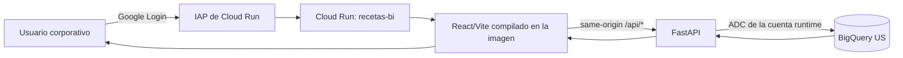

# Guía de despliegue de Recetas.BI en Cloud Run con IAP y BigQuery

## 1. Objetivo

Desplegar Recetas.BI como un único servicio de Cloud Run. Los usuarios autorizados acceden a la interfaz React/Vite mediante Identity-Aware Proxy (IAP). FastAPI sirve el frontend y la API; la API consulta BigQuery desde el servidor usando la identidad runtime de Cloud Run.

Este proyecto **no utiliza LLM, Gemini, Vertex AI para inferencia, AI Gateway, Kairos, JWT de modelo ni API keys de IA**. No aplicar la arquitectura de agentes de CatMan: aquí BigQuery es la fuente de datos y FastAPI es la capa server-side que la consulta.

Esta guía describe el estado del repositorio y el procedimiento previsto. No afirma que ya se haya desplegado este proyecto en GCP.

## 2. Arquitectura del proyecto



Solo existe un servicio Cloud Run: el Dockerfile de la raíz compila la web, copia su build a la imagen Python y FastAPI sirve la web junto con la API. En producción, el navegador llama rutas del mismo origen. No hace falta un backend Cloud Run separado, BFF adicional, CORS entre servicios ni una cuenta de servicio frontend.

La URL `run.app` puede ser enrutable desde Internet, pero el servicio se despliega privado (`--no-allow-unauthenticated`) y requiere autenticación/IAP. No conceder `allUsers` ni `allAuthenticatedUsers` como invocadores.

## 3. Qué hace cada archivo

| Archivo | Función |
| --- | --- |
| `deploy-cloudrun.ps1` | Comprueba requisitos, aprovisiona IAM opcionalmente y despliega Cloud Run |
| `Dockerfile` | Build multi-stage: React/Vite en Node y runtime FastAPI en Python |
| `.dockerignore` | Excluye secretos, entornos virtuales, `node_modules` y artefactos locales del build |
| `.gcloudignore` | Controla qué archivos se envían como fuente a Cloud Build |
| `backend/app.py` | Endpoints, acceso a BigQuery, health checks y montaje de la SPA compilada |
| `backend/requirements.txt` | FastAPI, Uvicorn y cliente BigQuery |
| `backend/tests/test_app.py` | Pruebas de contrato usando un repositorio BigQuery simulado |
| `web/src/api/httpClient.js` | Llama a `/api/*` desde el mismo origen |
| `web/src/api/index.js` | Usa el cliente real por defecto; los mocks solo se activan explícitamente |
| `web/vite.config.js` | En desarrollo reenvía `/api` a FastAPI local |
| `backend/.env.example` | Variables locales de BigQuery; no se copia a Cloud Run |
| `web/.env.example` | Variables Vite locales; nunca debe contener secretos |

## 4. Recursos fijados para este proyecto

| Configuración | Valor actual |
| --- | --- |
| Proyecto GCP | `tot-corp-planifcomer-cl-sbx` |
| Región Cloud Run | `southamerica-west1` (Santiago) |
| Ubicación BigQuery | `US` |
| Servicio Cloud Run | `recetas-bi` |
| Cuenta runtime reutilizada | `srv-planifcomer-cl-dev@tot-corp-planifcomer-cl-sbx.iam.gserviceaccount.com` |
| Cuenta Cloud Build | Identidad predeterminada ya configurada en el proyecto; confirmar con Cloud Engineering |
| Dataset de vistas | `tot_bi_cl_sbxpc_vw` |
| Dataset de datos | `tot_bi_cl_sbxpc_prd` |

Antes de repetir el proceso en otro proyecto, sustituir y validar proyecto, región, servicio, datasets y cuentas de servicio. No asumir que BigQuery usa la misma ubicación que Cloud Run: aquí Cloud Run está en Santiago y BigQuery en `US`.

## 5. Cómo obtiene y presenta los datos

FastAPI crea `bigquery.Client(project=BQ_PROJECT_ID, location=BQ_LOCATION)`. En Cloud Run, las credenciales provienen automáticamente de la cuenta runtime mediante Application Default Credentials (ADC). No se monta un JSON de cuenta de servicio ni se proporcionan credenciales al navegador.

El repositorio consulta vistas y tablas de `tot_bi_cl_sbxpc_prd` y `tot_bi_cl_sbxpc_vw`. Las consultas usan parámetros para valores de usuario y convierten tipos como `Decimal` y fechas a valores JSON.

Reglas operativas del producto:

- Solo se listan productos receta (`ind_receta = 'R'`) en divisiones J06/J07.
- El estado inicial es `cod_estado = 0` (ACT); `ind_activo` se mantiene como señal independiente.
- Si faltan malificación o peso, no se presenta el margen MP como margen final.
- La API no escribe cargas de malificación ni modifica tablas oficiales.
- Las simulaciones consultan costos PMM en el servidor y son borradores.
- Las simulaciones se guardan en memoria: se pierden al reiniciar, escalar a cero o reemplazar instancias/revisiones. No son almacenamiento persistente ni registro oficial.

Las consultas BigQuery generan costos. `BQ_MAX_BYTES_BILLED` puede limitar bytes por consulta, pero no es un presupuesto global. Revisar consumo y configurar presupuestos/alertas en GCP según la política del equipo.

## 6. Identidades y permisos requeridos

| Identidad | Recurso | Permiso mínimo previsto |
| --- | --- | --- |
| Cuenta runtime `srv-planifcomer-cl-dev` | Proyecto donde ejecuta queries | Permisos BigQuery existentes; confirmar `roles/bigquery.jobUser` |
| Cuenta runtime `srv-planifcomer-cl-dev` | Datasets `tot_bi_cl_sbxpc_prd` y `tot_bi_cl_sbxpc_vw` | Permisos de lectura existentes; confirmar `roles/bigquery.dataViewer` o acceso equivalente |
| Cloud Build identity predeterminada | Build/Artifact Registry/Cloud Run | Permisos que la organización ya le haya asignado; confirmar con Cloud Engineering |
| Desplegador | Cuenta runtime reutilizada | `iam.serviceAccounts.actAs`, normalmente mediante `roles/iam.serviceAccountUser` |
| Desplegador | Build identity | No requiere `actAs` si se usa la identidad predeterminada; sí si se especifica una cuenta existente |
| Agente de servicio IAP | Servicio Cloud Run | `roles/run.invoker` |
| Usuario o grupo final | Recurso IAP de `recetas-bi` | `roles/iap.httpsResourceAccessor` |

No conceder BigQuery Admin, Editor u Owner al runtime como atajo. Si una vista depende de otros datasets, pedir al administrador que habilite el acceso mínimo requerido; no dar Data Viewer sobre todo el proyecto sin justificación.

## 7. Prerrequisitos y responsabilidades

### Desplegador

- Windows PowerShell y Google Cloud CLI (`gcloud`) y BigQuery CLI (`bq`) disponibles en `PATH`.
- Sesión Google Cloud vigente y proyecto autorizado.
- Permisos para ejecutar Cloud Build/desplegar Cloud Run y `iam.serviceAccounts.actAs` sobre las cuentas asignadas.
- Verificación TLS activa. Si hay un proxy corporativo, configurar el certificado aprobado; no deshabilitar la validación TLS.

### Cloud Engineering

- Revisar y aprobar el aprovisionamiento de APIs, service accounts e IAM.
- Otorgar permisos de despliegue y `actAs` al desplegador.
- Habilitar IAP en Cloud Run después del primer despliegue privado.
- Autorizar el agente IAP como invocador y agregar usuarios/grupos con `roles/iap.httpsResourceAccessor`.
- Confirmar restricciones organizacionales, dominio admitido por IAP y dependencias IAM de las vistas BigQuery.

No se deben crear claves descargables de cuentas de servicio. Cloud Run obtiene identidad runtime mediante ADC.

## 8. Preparación inicial de infraestructura

El script `deploy-cloudrun.ps1` reutiliza cuentas existentes y tiene dos modos relevantes:

- Sin flags de aprovisionamiento: verifica que exista la cuenta runtime y despliega. Cloud Build usa la identidad predeterminada del proyecto, salvo que se indique otra cuenta existente.
- `-ProvisionInfrastructure -ProvisionOnly`: habilita APIs y añade los permisos BigQuery requeridos a la cuenta runtime existente; termina **sin desplegar** Cloud Run.

El script **no crea cuentas de servicio**. El modo de aprovisionamiento modifica APIs/IAM y debe ejecutarlo una identidad autorizada, tras revisar el script y obtener aprobación del Cloud Engineer.

Para identificar la cuenta de build predeterminada configurada en el proyecto,
el Cloud Engineer puede consultar:

```powershell
gcloud builds get-default-service-account --project=tot-corp-planifcomer-cl-sbx
```

El script no fija `--build-service-account`, así que deja que Cloud Build use
esa identidad existente. Solo si Cloud Engineering indica otra cuenta ya
creada se pasa con `-BuildServiceAccount CORREO_EXISTENTE`.

Desde la raíz de `catmanRECETAS`:

```powershell
gcloud auth login
gcloud config set project tot-corp-planifcomer-cl-sbx
.\deploy-cloudrun.ps1 -ProvisionInfrastructure -ProvisionOnly
```

El script reutiliza como runtime:

- `srv-planifcomer-cl-dev@tot-corp-planifcomer-cl-sbx.iam.gserviceaccount.com`.

Es la identidad runtime ya usada en CatMan y se reutiliza para evitar crear
otra cuenta. Antes de productivo, Cloud Engineering debe revisar su IAM actual
y reducir permisos que excedan las necesidades de Recetas.BI; no asumir que
una cuenta existente cumple automáticamente el principio de mínimo privilegio.

El modo de aprovisionamiento añade a esa cuenta `roles/bigquery.jobUser` en el proyecto y `roles/bigquery.dataViewer` solo en los dos datasets. Como la cuenta ya tiene permisos en CatMan, Cloud Engineering debe revisar los bindings heredados antes de ejecutar ese modo; el script agrega permisos y no reemplaza los existentes.

Cloud Build usa la identidad predeterminada del proyecto porque el script no pasa `--build-service-account`. Cloud Engineering debe confirmar cuál es esa identidad y que tenga permisos para construir y publicar la imagen. Si el proyecto requiere seleccionar explícitamente una cuenta **que ya exista**, se puede pasar `-BuildServiceAccount CORREO_EXISTENTE`; el script la valida y no la crea. No asumir un correo de build sin confirmación.

El desplegador necesita `roles/iam.serviceAccountUser` sobre la cuenta runtime para adjuntarla, además de permisos de despliegue de Cloud Run, Cloud Build y Artifact Registry. Si se especifica una cuenta build existente, también necesita `actAs` sobre ella. El script no otorga `actAs` al desplegador.

El script habilita APIs de Cloud Run, Cloud Build, Artifact Registry, BigQuery e IAM durante el modo de aprovisionamiento. No habilita IAP.

## 9. Desplegar el servicio privado

Una vez que infraestructura y permisos estén listos, desplegar desde la carpeta del proyecto:

```powershell
Set-Location 'RUTA\A\catmanRECETAS'
gcloud auth login
.\deploy-cloudrun.ps1
```

El script usa `gcloud run deploy --source=<raíz>` con el Dockerfile raíz. Cloud Build compila Vite y empaqueta FastAPI más la interfaz. No hacen falta Docker ni Node instalados localmente para desplegar, aunque Node sí sirve para validar el frontend localmente.

El despliegue configura, entre otros valores:

- `--project=tot-corp-planifcomer-cl-sbx`
- `--region=southamerica-west1`
- Cuenta runtime existente `srv-planifcomer-cl-dev`; build identity predeterminado del proyecto salvo override explícito con una cuenta existente
- Puerto `8080`, CPU `1`, memoria `1Gi`, concurrencia `8`
- Escalado `min=0`, `max=1` y timeout `300s`
- `--no-allow-unauthenticated --invoker-iam-check --ingress=all`
- `BQ_PROJECT_ID=tot-corp-planifcomer-cl-sbx`, `BQ_LOCATION=US`
- `CORS_ORIGINS=` vacío, porque el frontend y la API son del mismo origen

`ingress=all` significa que el endpoint de red de Cloud Run es alcanzable; no equivale a acceso anónimo. El control de invocación se mantiene y, al habilitar IAP, Cloud Run exige autenticación.

El script falla si `auth/disable_ssl_validation` está activo. No deshabilitar TLS para resolver problemas de certificados.

## 10. Probar el servicio antes de IAP

El servicio desplegado es privado. Para probarlo antes de habilitar IAP, el README/script recomienda el proxy autenticado de gcloud:

```powershell
gcloud run services proxy recetas-bi `
  --project=tot-corp-planifcomer-cl-sbx `
  --region=southamerica-west1 `
  --port=8080
```

El usuario que ejecuta el proxy necesita `roles/run.invoker` en el servicio. El proxy agrega su identidad; no volver el servicio público para probarlo. No enlazar el proxy a `0.0.0.0` ni compartir el puerto con la red.

En un segundo terminal o navegador abre `http://127.0.0.1:8080`.

### Health checks

```powershell
Invoke-RestMethod http://127.0.0.1:8080/api/health
Invoke-RestMethod http://127.0.0.1:8080/api/health/bigquery
```

`/api/health` prueba que FastAPI responde. `/api/health/bigquery` ejecuta `SELECT 1`; **no comprueba** acceso a las tablas/vistas de negocio.

### Pruebas funcionales

1. Abrir Recetas y revisar listado/filtros.
2. Expandir una receta y validar componentes/alertas.
3. Revisar Alertas y Malificación.
4. Abrir `/simulador`, crear un borrador con insumos PMM y nuevos, y validar costos.
5. Abrir directamente `/alertas`, `/carga-masiva` y `/simulador`, refrescar y confirmar que FastAPI sirve la SPA.
6. Enviar SKU PMM inexistente y confirmar que la API lo rechaza; no debe aceptar como oficial el costo enviado por el navegador.
7. Confirmar que simulaciones no escriben tablas oficiales.

El modo de producción fuerza `VITE_USE_MOCK=false` en el Dockerfile. No validar el despliegue con mocks.

## 11. Habilitar IAP y autorizar usuarios

El script no configura IAP ni añade usuarios. Un Cloud Engineer debe activar IAP directamente sobre Cloud Run después de validar el servicio privado.

Ejemplo de actualización para habilitar IAP, usando una versión de `gcloud` compatible:

```powershell
gcloud run services update recetas-bi `
  --project=tot-corp-planifcomer-cl-sbx `
  --region=southamerica-west1 `
  --iap
```

El agente IAP del proyecto tiene el formato:

```text
service-PROJECT_NUMBER@gcp-sa-iap.iam.gserviceaccount.com
```

Calcular el principal para el proyecto actual:

```powershell
$Project = 'tot-corp-planifcomer-cl-sbx'
$ProjectNumber = (gcloud projects describe $Project --format='value(projectNumber)').Trim()
$IapSA = "service-$ProjectNumber@gcp-sa-iap.iam.gserviceaccount.com"
```

Si al habilitar IAP no se concede automáticamente, el Cloud Engineer debe dar al agente `roles/run.invoker` sobre `recetas-bi`:

```powershell
gcloud run services add-iam-policy-binding recetas-bi `
  --project=tot-corp-planifcomer-cl-sbx `
  --region=southamerica-west1 `
  "--member=serviceAccount:$IapSA" `
  --role=roles/run.invoker
```

Autorizar usuarios individuales (preferir un grupo corporativo mantenido por TI para equipos):

```powershell
$Users = @('USUARIO1@EMPRESA', 'USUARIO2@EMPRESA')
foreach ($UserEmail in $Users) {
  gcloud iap web add-iam-policy-binding `
    --resource-type=cloud-run `
    --service=recetas-bi `
    --region=southamerica-west1 `
    --project=tot-corp-planifcomer-cl-sbx `
    "--member=user:$UserEmail" `
    --role=roles/iap.httpsResourceAccessor
  if ($LASTEXITCODE -ne 0) { throw "No se pudo autorizar $UserEmail" }
}
```

Para un grupo autorizado, usar `--member=group:GRUPO@EMPRESA`. No usar `allUsers`, `allAuthenticatedUsers` ni desactivar IAM para resolver un `Access Denied`.

Después, abrir la URL `run.app` directamente: el usuario autorizado inicia sesión por IAP; otro usuario debe recibir acceso denegado. IAP protege el acceso al servicio; no concede acceso BigQuery al navegador ni cambia la cuenta runtime.

## 12. Configuración y costo de BigQuery

- La ubicación de BigQuery debe permanecer `US`; no cambiarla para que coincida con la región del servicio.
- `BQ_MAX_BYTES_BILLED` es opcional y limita bytes procesados por consulta, no el gasto total del proyecto.
- Cloud Build y Artifact Registry pueden generar costos además de BigQuery y Cloud Run.
- Revisar presupuestos/alertas del proyecto y métricas de bytes procesados.
- Si se necesita costo máximo por query, medir primero las consultas válidas y luego elegir un límite que no las rompa.

## 13. Diagnóstico

| Síntoma | Revisar |
| --- | --- |
| `You don't have access` antes de cargar la app | `roles/iap.httpsResourceAccessor` del usuario/grupo y que el host IAP sea el servicio `recetas-bi` correcto |
| Servicio privado devuelve 401/403 sin login | Esperado; probar por `gcloud run services proxy` o con usuario autorizado vía IAP |
| `/api/health` funciona pero `/api/health/bigquery` falla | ADC runtime, `roles/bigquery.jobUser`, dataset, `roles/bigquery.dataViewer` y ubicación `US` |
| BigQuery responde `Access Denied` sobre una vista | Identificar dependencias de la vista y pedir permisos mínimos; no otorgar acceso a todo el proyecto |
| Frontend muestra fixtures/mock | Verificar que el build Cloud Run use `VITE_USE_MOCK=false` |
| Refresh de una ruta da 404 | Confirmar `WEB_DIST_DIR`, build de Vite y rutas SPA declaradas en FastAPI |
| El contenedor queda Ready pero UI/API falla | Revisar logs de Cloud Run y probar rutas funcionales, no solo readiness |
| Simulación desaparece | Es el comportamiento actual: los borradores se almacenan en memoria y no son persistentes |

Logs:

```powershell
gcloud logging read 'resource.type=cloud_run_revision AND resource.labels.service_name=recetas-bi' `
  --project=tot-corp-planifcomer-cl-sbx `
  --limit=50 `
  --format='table(timestamp,severity,textPayload)'
```

No copiar tokens, credenciales, filas sensibles ni valores de entorno secretos a tickets/logs.

## 14. Pruebas antes de nuevas revisiones

Desde la raíz del repo:

```powershell
Push-Location backend
py -3 -m unittest discover -s tests -v
Pop-Location

Push-Location web
npm ci
npm run build
Pop-Location

git diff --check
```

El repositorio adjunto no declara un script frontend `typecheck`; verificar el build disponible en `web/package.json`. La prueba backend usa `FakeRepository` y no requiere acceso real a BigQuery.

## 15. Límites y siguientes iteraciones

- No se crean ni migran tablas/vistas de BigQuery; coordinarlo con el propietario del modelo.
- No se implementa login propio: IAP es la puerta de entrada aprobada.
- No se debe publicar anónimamente el servicio.
- Las simulaciones requieren almacenamiento persistente si deben sobrevivir reinicios, escalado a cero o nuevos despliegues; considerar base de datos solo con diseño/aprobación.
- Si se agrega escritura o carga de archivos, definir autorización, auditoría, validación, idempotencia y rollback antes de implementarlo.
- Revisar límites de concurrencia/escalado, residencia de datos, retención de logs y presupuesto con Cloud Engineering.
- No añadir gateway LLM, API keys de Gemini, JWT de Kairos ni Langfuse a este proyecto salvo que cambie explícitamente el requisito.

## Referencias

- [README del proyecto](README.md)
- [README de backend](backend/README.md)
- [README de frontend](web/README.md)
- [IAP directo en Cloud Run](https://docs.cloud.google.com/run/docs/securing/identity-aware-proxy-cloud-run)
- [Despliegue desde código fuente](https://docs.cloud.google.com/run/docs/deploying-source-code)
- [Control de acceso a BigQuery](https://cloud.google.com/bigquery/docs/access-control)
